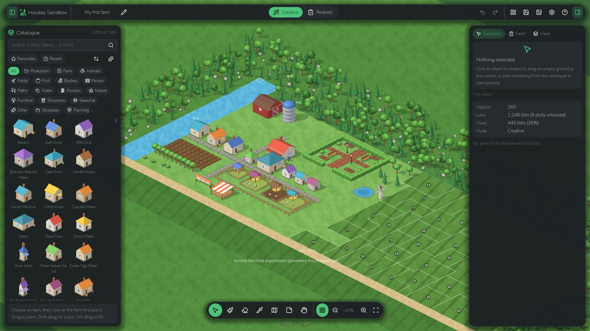
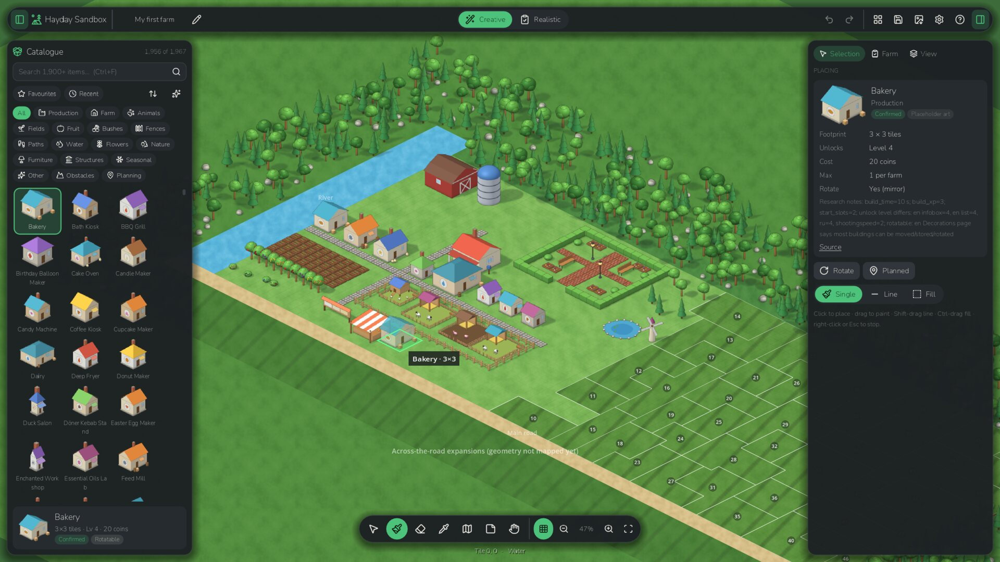
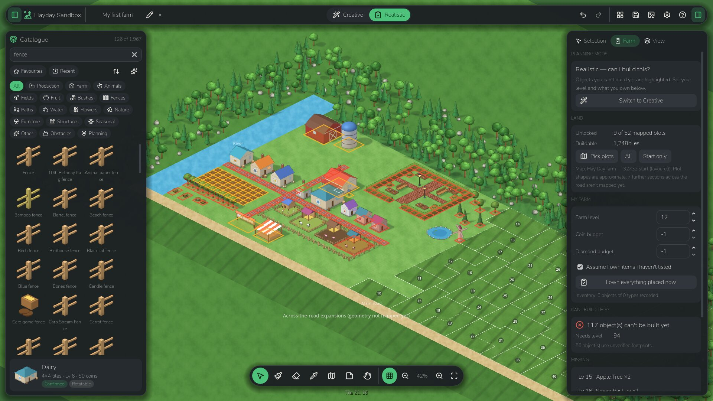
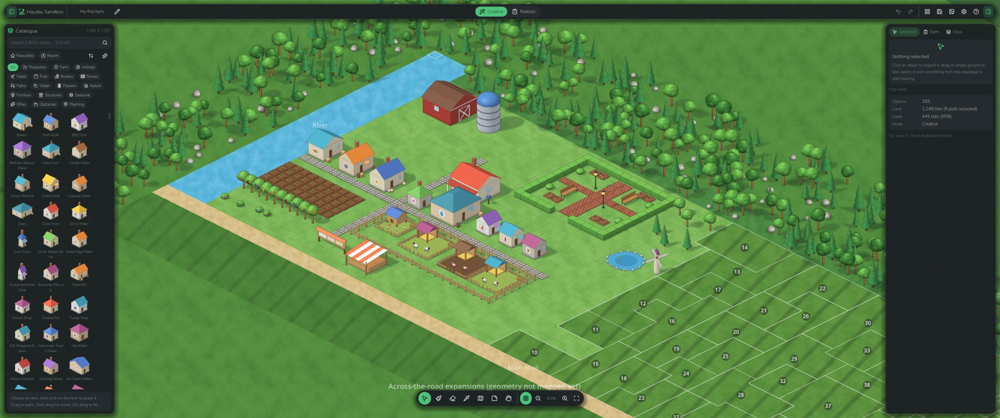
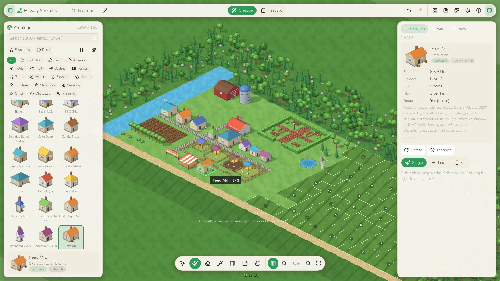

# Hayday Sandbox

An offline, isometric **farm layout designer** for planning Hay Day farms. It is a planning editor only: there is
no gameplay and no grinding; coins and diamonds appear only as researched prices in your budget. Design freely in
**Creative Mode** (the full sandbox), switch to **Realistic Mode** to see what your farm level, inventory, land and
budget actually allow, then plan the rebuild: budget, areas, phases, shopping list, build checklist and a
step-by-step guide.

> **Unofficial fan tool.** This material is unofficial and is not endorsed by Supercell. For more information see
> Supercell's Fan Content Policy: <https://www.supercell.com/fan-content-policy>. Hayday Sandbox contains **no
> Supercell artwork**: every sprite is original placeholder art generated by this project. Item facts (names,
> footprints, unlock levels) come from community wikis and are labelled with their confidence.



## What it does today

* **Isometric farm canvas** in the 2:1 grid of the game's tile frame. Smooth zoom toward the cursor (12–400 %),
  pan with inertia, a camera that stays inside the world, fit/home keys and up to nine saved views per layout.
  Depth order is a real topological sort that is updated incrementally after each edit.
* **Original procedural world** for the public map: grass, road, a bridge over the river, forest and a cliff along
  the north edge. The ground is drawn by this project; the cliff is a visual choice, not map data. A few
  placeholder decorations (windmills, ponds, fountains) have ambient animation. Seasons can only be chosen when
  installed art has seasonal variants, which the public placeholders don't.
* **Main farm only**: the 32×32 starting land plus the 52-plot main expansion section (shapes reconstructed from
  the wiki map). The upper plots and the across-the-road sections are listed in the map file but not drawn because
  their tile geometry is unknown.
* **Fixed landmarks** (farmhouse, order board, truck, roadside shop, newspaper mailbox) are part of the world, not
  objects. They can be selected and inspected but never moved, rotated, copied or deleted. In the public map their
  positions are **approximate**, so they are drawn as a guide and do **not** block placement.
* **1,967-item catalogue** built from fan-wiki research, with instant search, a category rail, favourites,
  recently used, sorting and filters. Each item shows its footprint confidence (*confirmed / community /
  unverified / unknown*) and badges for footprint, unlock level and art source. See
  [catalogue coverage](docs/CATALOG_COVERAGE.md).
* **Editing**: click/drag placement with per-tile green/red validity and plain-language reasons ("Blocked by
  Bakery"), paint strokes, lines (Shift), rectangle fills (Ctrl), multi-select, box select, click-again to select the
  object behind, an "Objects here" list on right-click, live drag preview with blocker outlines, optional snap to the
  nearest free spot, copy/cut/paste, duplicate, rotate (Hay Day's mirror, only where the game allows), lock, group,
  eyedropper, eraser, notes, auto-connecting fences and paths. Every edit is an undoable command
  (one gesture = one undo step).
* **Layout tools**: symmetry placement (three mirror lines), repeat arrays with a live preview, align and equal
  spacing, fence/path line and outline brushes, and reusable **stamps** saved as `.hdstamp` files that can be
  exported and imported.
* **Realistic Mode**: a non-destructive "can I build this?" report. It covers required level, items above your
  farm level, plots your level can't unlock yet, inventory shortages, per-farm maximums, land you'd need, estimated
  cost from known prices only (unknown prices are listed, never invented) and budget checks. Objects from other
  areas of the game are flagged. In Realistic Mode the eyedropper, paste and duplicate refuse items above your farm
  level. The issues list groups problems by reason.
* **Future planning**: *planned* (ghost) objects and editor-only reserved-space markers.
* **Farm planning** (workflow strip in the top bar: Design → Budget → Areas → Phases → Shop → Build → Guide; see
  [PLANNING.md](docs/PLANNING.md)):
  * **Budget chip** on the canvas: what the selection, active area, active phase or whole farm costs, per currency
    (coins, diamonds, vouchers and event currencies are never converted into each other), in three modes:
    *Design cost*, *To buy* (owned copies deducted) and *Remaining* (also what you bought during the project).
    Unknown prices, items that can't be bought and items with no inventory record are counted next to the total,
    never treated as 0.
  * **Plan panel** (J) with the tabs Budget, Areas, Phases, Shop, Build, Guide and Accuracy. Areas are rectangles
    or polygons (also drawn with the notes tool, N); phases set the build order and get Design / To buy /
    Remaining totals, status, targets and "what my balances pay for". The Shop tab is a grouped shopping list
    with search, filters, a "bought" counter and CSV export; the Build tab is a checklist (not acquired / to
    place / placed); the Guide tab gives numbered steps with directions relative to the farm's landmarks, and
    exports HTML (print it to PDF from a browser), CSV, JSON, text and PNG. A "Can I build this?" card lists
    blocking issues apart from costs.
  * **Price data** (`data/prices/hayday_prices.json`) from public fan wikis, with sources and a confidence per
    record: 1,962 of the 1,967 items have a record, but only 447 can be bought for a known price (338 in the shop,
    66 for vouchers, 38 for event currency, 5 free). 1,514 are not sold or are rewards, and 1 price is unknown.
    How the per-copy price step is counted is not established. You can override any price; overrides stay in
    your user folder. See [pricing research](docs/research/PRICING_RESEARCH.md).
  * **Inventory**: copies owned and bought, balances (coins, diamonds, vouchers, expansion supplies), CSV/JSON
    import and export. A blank entry means "not recorded", which is not the same as 0.
  * **My real farm**: a snapshot of your current farm as a baseline. Copies on it count as owned, the guide moves
    objects from it, and *Compare with my farm* tints unchanged, moved (with arrows), new and removed objects.
  * **Overview map** (Shift+M) and **object layers** (show, dim or hide decorations, buildings, trees, fences,
    paths…; view only).
  * **Accuracy report**: how far the map, landmarks and footprints can be trusted. The public map is an
    approximation reconstructed from wiki images and tables; its landmark positions are approximate.
* **Layouts**: unlimited local layouts, gallery with thumbnails, templates, rename/duplicate/delete (to trash),
  import/export, autosave with crash recovery, revision snapshots on every save, versioned crash-safe files
  (schema 4; older files are migrated, zones become planning areas, and the original file is backed up before the
  first save).
* **Screenshot references**: several reference images per layout, each with its own opacity, visibility, lock and
  order, aligned to the grid by **calibration from 2 or more points** (3 or more also correct a stretched image;
  from 4 points the error of each point is measured in tiles and pixels). All changes are undoable.
* **Compare** two layouts: added / removed / moved objects highlighted on the farm, plus item count changes.
* **Export** PNG images of the whole farm, unlocked land, objects or the view, up to poster size (tiled
  rendering), with optional transparency, grid and labels.
* **Your own artwork**: import PNG/WebP/JPG folders or sprite sheets into a *private* pack, then tune anchors and
  scale in the Asset Manager. A pack can also carry world data (landmark positions, terrain, initial objects) and
  catalogue corrections. That code path is covered by tests with synthetic packs only; see
  [PRIVATE_ASSETS.md](docs/PRIVATE_ASSETS.md).
* **Interface**: light and dark themes, UI scale 100–300 %, resizable and collapsible side panels with remembered
  widths, an inspector that hides itself when nothing needs it, and an ambient-animation setting (Off / Reduced /
  Full; the default follows the OS reduce-motion preference).
* Fully **offline**, no accounts, no telemetry. Everything is stored locally.

## Run it

**Windows (portable):** download `HaydaySandbox-windows-x86_64.zip` from the latest CI run (Actions → *CI* →
artifacts) or build it yourself (below), unzip anywhere and run `HaydaySandbox.exe`. Requires OpenGL 3.3.
Your layouts live in `%APPDATA%\HaydaySandbox\`.

**From source (any OS):** install [Godot 4.7.2](https://godotengine.org/download) and run
`godot --path .` in this folder (or open `project.godot` in the editor and press F5).

**Build the Windows app:** `tools/build/build.sh` (Linux/macOS shell, Godot on PATH). It downloads export
templates if needed, exports `build/windows/HaydaySandbox.exe` and zips a portable bundle. See
[docs/DEVELOPMENT.md](docs/DEVELOPMENT.md).

### Windows quick start for developers

```powershell
# Point the runners at the Godot 4.7.2 executable (or put `godot` on PATH).
$env:GODOT = 'C:\path\to\Godot_v4.7.2-stable_win64.exe'

# Headless checks: import, scripts, unit tests, self-test, data, leak guard, coverage. Logs: artifacts\checks\
powershell -ExecutionPolicy Bypass -File tools\ci\windows_checks.ps1            # add -Perf for benchmarks
powershell -ExecutionPolicy Bypass -File tools\ci\windows_checks.ps1 -SkipImport -Tag mytag

# One headless Godot command (adds --headless --path .), e.g. a filtered unit-test run
powershell -ExecutionPolicy Bypass -File tools\ci\run_godot.ps1 --script res://tests/run_tests.gd -- --filter=budget

# Screenshots of the real app (OpenGL) into artifacts\screens\
powershell -ExecutionPolicy Bypass -File tools\ci\visual_tests.ps1 'overview,selection' 1920x1080:1
```

The runners give every Godot child a fresh, temporary `APPDATA`, so your real layouts, settings and any installed
asset pack are never read or changed. They share one lock, so runs started from parallel shells wait for each
other instead of importing and testing at the same time. Capture windows open off-screen and never take focus. Run one visual run at a
time: it writes a temporary `override.cfg` into the project folder and refuses to start if one already exists.
Details: [docs/TESTING.md](docs/TESTING.md).

**Private original-art pack (optional, personal use only):** if you are allowed to use original Hay Day art
privately, `tools\private_assets\acquire_windows.bat` (or installing a pack zip from Settings) builds and installs
it into your user folder. It is never part of this repository, CI or releases. See
[docs/PRIVATE_ASSETS.md](docs/PRIVATE_ASSETS.md). Contributors: run `tools/ci/install_git_hooks.sh` once per clone
(Git Bash on Windows).

## Quick tour

| | |
|---|---|
|  |  |
|  |  |

Press **F1** in the app for every shortcut (the help is built from the real key bindings). Highlights:

| Keys | Action |
|---|---|
| **V** · **B** · **E** · **I** · **M** · **N** · **D** | select · place · erase · eyedropper · land · notes & areas · pan tool |
| **J** · Shift+M | Plan panel · overview map |
| Space / middle / right-drag | pan with any tool |
| Shift+drag · Ctrl+drag | line of items · rectangle fill |
| Click again on the same spot | select the object behind (cycles); right-click → *Objects here* |
| Alt while dragging | toggle snap to free space |
| **R** · **L** · **P** | rotate (mirror) · lock · planned |
| Ctrl+C / X / V · Ctrl+D | copy / cut / paste · duplicate |
| Ctrl+Z · Ctrl+Shift+Z / Ctrl+Y | undo · redo |
| **F** · Shift+F · **H** / Home | fit selection or farm · whole world · centre the farmhouse |
| 1…9 · Ctrl+1…9 | go to · save a view (saved with the layout, undoable) |
| **[** · **]** · Tab | collapse catalogue · show/hide inspector · hide all panels |
| Ctrl+M · Ctrl+S · Ctrl+F | Creative/Realistic · save · search |

## Documentation

* [Product vision](docs/PRODUCT_VISION.md) · [Features](docs/FEATURES.md) · [Farm planning](docs/PLANNING.md) · [Roadmap](docs/ROADMAP.md) · [Known issues](docs/KNOWN_ISSUES.md)
* [Architecture](docs/ARCHITECTURE.md) · [Development & builds](docs/DEVELOPMENT.md) · [Testing](docs/TESTING.md)
* [Asset pipeline](docs/ASSET_PIPELINE.md) · [Private original-art pack](docs/PRIVATE_ASSETS.md) · [Item database](docs/ITEM_DATABASE.md) · [Catalogue coverage](docs/CATALOG_COVERAGE.md)
* Research: [legal & licensing](docs/research/LEGAL_AND_LICENSING.md) · [asset sources](docs/research/ASSET_SOURCES.md) ·
  [asset formats](docs/research/ASSET_FORMATS.md) · [placement](docs/research/PLACEMENT_RESEARCH.md) ·
  [Hay Day reference](docs/research/HAYDAY_REFERENCE.md) · [item data](docs/research/ITEM_DATA_RESEARCH.md) ·
  [pricing](docs/research/PRICING_RESEARCH.md) · [known uncertainties](docs/research/KNOWN_UNCERTAINTIES.md)

## Licence

Code: MIT ([LICENSE](LICENSE)). Generated placeholder art: CC0. Third-party: Nunito font (SIL OFL 1.1), Lucide
icons (ISC), item facts/plot tables adapted from the Hay Day Wiki (CC BY-SA) — see
[docs/THIRD_PARTY_NOTICES.md](docs/THIRD_PARTY_NOTICES.md). Hay Day is a trademark of Supercell; this project is
not affiliated with, endorsed, sponsored or approved by Supercell.
